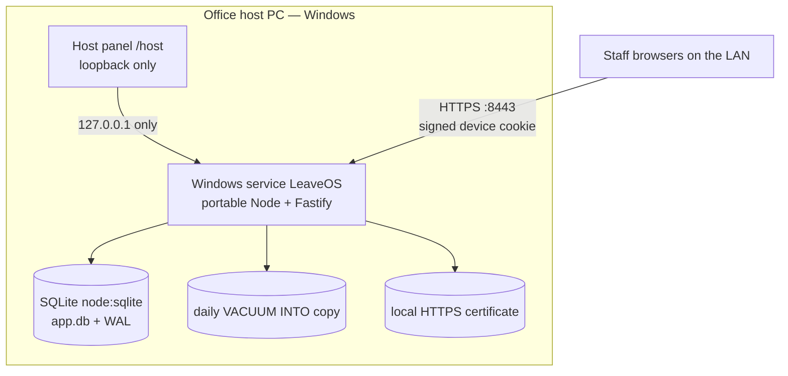
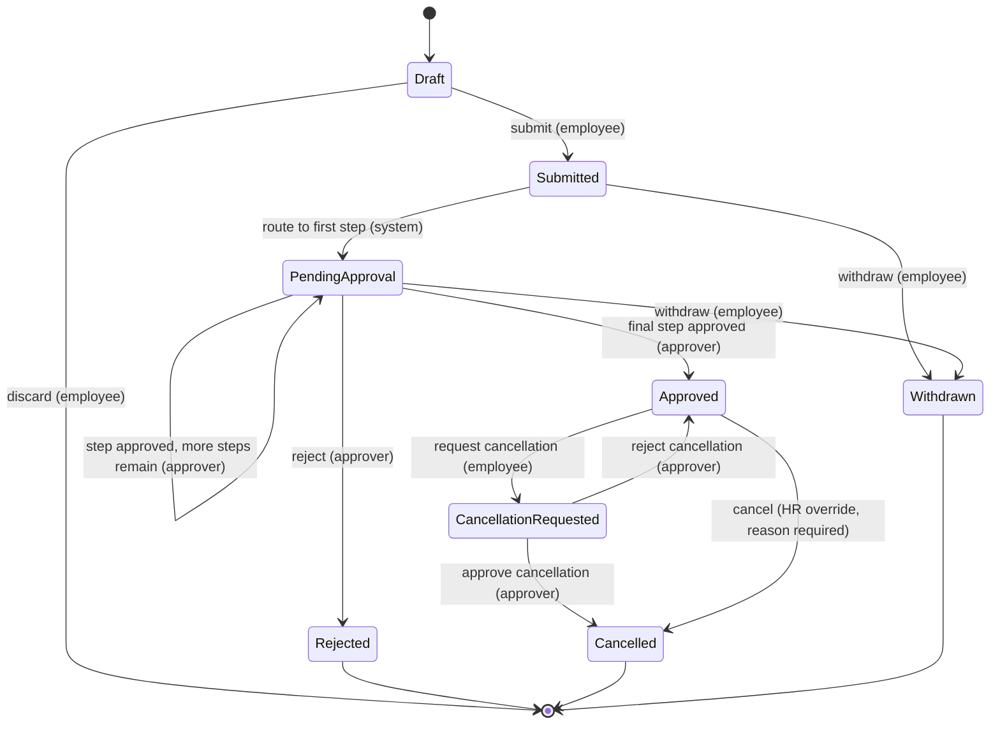

# Architecture

What ships for the office: one Windows computer runs Leave OS as a Windows service.
Staff use a browser on the office LAN. There is no cloud dependency for leave,
sign-in, or the ledger.

The hosted Vercel preview is frozen. A deploy migrates and does not load the Navalur
dataset. That load is `pnpm db:reset:navalur` only.

`apps/desktop` (Electron) is not the office install.

---

## 1. Processes and boundaries



- Only the server process opens the database.
- The host panel is a page on that server, not a second process. Requests that are not
  from this computer are refused.
- Staff sign in from a browser. The first browser gets a signed httpOnly device cookie
  and a pending row. An administrator approves it. Another person on that browser, or
  the same person on a second approved browser, is blocked, audited, and reported.
- Production serves HTTPS with a certificate written on first start. HTTP is only
  `LEAVEOS_HTTP_FALLBACK`. Staff trust `cert.pem` (see `docs/TLS-TRUST.md`). Do not
  continue past a certificate warning. DW-13 stays open.
- Setup (`docs/INSTALLER.md`) is one program with a Next page and a Finish page. It
  copies the bundled Node runtime and the app, registers and starts the service, opens
  TCP 8443, writes the certificate and trusts it on this computer, creates the backup
  folder under ProgramData, and sets plugged-in sleep and hibernate to never. Finish
  opens the host panel. Uninstall reverses the service, the firewall rule, the shortcut,
  the certificate trust, and the power change. It keeps the data and backups unless the
  person uninstalling chooses to delete them. The setup program is unsigned (DW-14).
- A production host copies the database once a day with `VACUUM INTO` into a configurable
  folder and drops copies older than the retention. Restore is staged and applied the
  next time the database opens.
- The SQLite file stays on this computer's disk. It is not on a network share.

---

## 2. Repository layout

```
apps/
  web/          React + Vite. The employee/manager/HR/admin site.
  server/       Fastify API, static serving, scheduled jobs, migrations runner.
  desktop/      Not the office install.
packages/
  domain/       Business rules. No SQLite, no Fastify, no React. Pure TypeScript.
  database/     node:sqlite (and a Postgres adapter for the frozen preview), SQL migrations.
  auth/         Password hashing, sessions, CSRF, lockout, permission evaluation.
  contracts/    Zod schemas and shared types. Source of both validation and OpenAPI.
  ui/           Design tokens and reusable components.
  config/       Zod-validated configuration loading.
docs/
scripts/
```

**The dependency rule.** `domain` depends on nothing in this repo. `database` depends on
`domain` and `contracts`. `server` depends on all packages. `web` depends on `contracts`
and `ui` only. `desktop` depends on `config` only — it never imports the database layer.
Enforced by an ESLint boundary rule, not by good intentions.

**Why `domain` is storage-agnostic.** It defines repository _interfaces_; `database`
implements them. The office host uses `node:sqlite`. The frozen preview uses the Postgres
adapter. Neither path rewrites the rules.

---

## 3. Ports and addresses

| Environment | What                | Address                              | Notes                                                                                                                                |
| ----------- | ------------------- | ------------------------------------ | ------------------------------------------------------------------------------------------------------------------------------------ |
| Production  | Employee site + API | `https://sns-leave:8443`             | Also `https://sns-leave.local:8443`. The LAN IP address is the fallback. The name defaults to `sns-leave` and is changed in settings |
| Production  | Host panel          | `https://127.0.0.1:8443/host`        | This computer only. Status, QR, service, backup, restore, waiting browsers, health                                                   |
| Production  | Health endpoint     | `https://<lan-address>:8443/healthz` | No authentication, no data — liveness only                                                                                           |
| Development | Vite dev server     | `http://localhost:5173`              | Proxies `/api` to the server                                                                                                         |
| Development | Fastify             | `http://localhost:3000`              | HTTP. Tests stay on HTTP                                                                                                             |

Port and hostname are configurable at first run. A port conflict is detected at startup
and reported as a human-readable error with the occupying process named, not as a stack trace.

The office name defaults to `sns-leave`. Staff open `https://sns-leave:8443` and
`https://sns-leave.local:8443`. The host answers mDNS A queries for `sns-leave.local` and
publishes an `_https._tcp` service record. It also answers LLMNR for the single-label name
`sns-leave`, which is how Windows resolves a name without `.local`. The LAN IP address
remains on the host panel as a fallback, with its own QR code.

A NetBIOS alias is not set. Windows reads an extra NetBIOS name from `OptionalNames` only
when the Server service restarts, and restarting that service drops file shares. Renaming
the computer would replace its own name and needs a reboot. Neither belongs in a setup
program that asks no questions. DW-12 stays open until the company names the network person
who will confirm the final hostname. An administrator can change `sns-leave` later, on the
host panel or with `PUT /api/v1/settings/hostname`, without reinstalling. The certificate
is rewritten to include the new name; the service must be restarted before staff use it.

---

## 4. Request path

```
Browser
  → TLS termination (Fastify, LAN certificate)
  → security headers + strict CSP
  → request-id assignment (echoed in every response and every log line)
  → rate limiter (strict on auth routes)
  → session cookie resolution → authenticated principal
  → CSRF check (non-GET only)
  → Zod schema validation of params, query, and body
  → route handler: thin. Translates HTTP to a use-case call.
  → USE-CASE  ← permission check happens HERE, with the principal and the target
  → domain rules (pure, testable, no I/O)
  → repository (parameterised SQL, inside one transaction)
  → response envelope
```

**Permission enforcement lives in the use-case, not the route.** A route that forgets its
guard fails a test; a use-case cannot be invoked without a principal because the principal
is a required argument of every use-case signature. Hidden buttons are a courtesy to the
user, never a control.

---

## 5. API conventions

Versioned under `/api/v1`. JSON only.

**Success**

```json
{ "data": {}, "meta": { "requestId": "01J...", "page": { "cursor": "...", "limit": 50 } } }
```

**Error** — one envelope, always.

```json
{
  "error": {
    "code": "LEAVE_INSUFFICIENT_BALANCE",
    "message": "Not enough casual leave for these dates.",
    "details": [{ "path": "endDate", "message": "Exceeds available balance by 1.5 days." }],
    "requestId": "01J..."
  }
}
```

- `code` is a stable machine string; `message` is human-readable and safe to display.
- Validation failures come from the same Zod schemas that generate the OpenAPI document.
- Pagination is cursor-based. Filter and sort fields are validated against an allowlist —
  a client cannot sort by `password_hash`.
- The OpenAPI document is generated from the `contracts` package, so it cannot drift.
- 401 (not authenticated) and 403 (authenticated, not permitted) are distinct, and a 403
  never reveals whether the target record exists.

---

## 6. Configuration

Loaded by `packages/config`, validated by Zod at startup. The process refuses to start on
an invalid configuration, with a message naming the offending key. Sources, in order:
built-in defaults → config file in the data folder → environment variables.

Secrets (certificate passphrase, optional SMTP password) are stored via a Windows
OS-protected mechanism (DPAPI), never in the config file, never in the repository.

Default data folder: `%PROGRAMDATA%\SimonAndSons\LeaveOS\` — chosen at first run,
containing `db\`, `attachments\`, `backups\`, `logs\`, `certs\`, `config.json`. Restrictive
ACLs are applied on creation, and verified by the health check.

---

## 7. Leave request state machine

The heart of the product. Every transition names its actor, its guard, its side effects,
and its audit event.



**Approver resolution (D-08/D-09).** Employee and Manager requests route to HR Officer;
HR requests route to Admin; Admin requests route to another Admin where one exists, and
otherwise to the requesting Admin as a labelled self-approval. Escalation to Admin is
automatic when no active HR account exists, when all HR accounts are disabled, when the
assigned HR approver is on approved leave covering the decision date, or when a configurable
SLA elapses. **Managers do not approve leave.** All of this is workflow _configuration_, not
branching in code — see [ADR 0009](adr/0009-approval-routing.md).

| Transition               | Actor                          | Guard                                                                                              | Ledger effect                                | Other effects                                                            |
| ------------------------ | ------------------------------ | -------------------------------------------------------------------------------------------------- | -------------------------------------------- | ------------------------------------------------------------------------ |
| submit                   | request owner                  | policy validated, balance sufficient, dates not in a locked period, attachment present if required | `PENDING_HOLD` (negative, reserved)          | audit, route to approval steps, notify approvers in-app **and by email** |
| approve step (not final) | current step approver          | step is current, actor is permitted, request version matches                                       | none                                         | audit, advance step, notify next approver                                |
| approve (final)          | final approver                 | as above                                                                                           | `PENDING_HOLD` released, `DEDUCTION` written | audit, notify employee, calendar updated                                 |
| reject                   | current step approver          | as above, reason required                                                                          | `PENDING_HOLD` released                      | audit, notify employee                                                   |
| withdraw                 | request owner                  | not yet finally approved                                                                           | `PENDING_HOLD` released                      | audit, notify approvers                                                  |
| request cancellation     | request owner                  | approved, and start date rule per policy                                                           | none                                         | audit, notify approver                                                   |
| approve cancellation     | approver                       | cancellation pending                                                                               | `CANCELLATION_CREDIT`                        | audit, notify employee, calendar updated                                 |
| HR cancel                | `leave.request.cancel:company` | reason required                                                                                    | `CANCELLATION_CREDIT`                        | audit with reason, notify employee and manager                           |

**Concurrency.** A decision is one transaction: read the request `FOR UPDATE`-equivalent
(SQLite: the write transaction serialises), assert the expected `version`, assert the state
transition is legal, write the ledger row, write the audit event, write the outbox row,
bump `version`, commit. A second approver arriving concurrently fails the version assertion
and receives "this request was already decided by <name>", not a double deduction.

**Idempotency.** Submit, approve, and import all accept an `Idempotency-Key`. The key,
its request hash, and its response are stored; a replay returns the original response
rather than acting twice.

---

## 8. Host control panel

The office control panel is `GET /host` on the server. It answers only for loopback
(`127.0.0.1`, `::1`). A LAN address receives a permission-denied page.

It shows whether the server is answering, the database check, and the Windows service
as **Running** when the service is running. It shows backup age, certificate expiry, and
free disk. It shows `https://sns-leave:<port>`, `https://sns-leave.local:<port>`, and the
LAN IP address, each with a QR code. The office name is edited on that page.
Forms start, stop, or restart the `LeaveOS` service, take a backup, stage a restore for
the next start, and approve a browser that is waiting. Posts carry a confirmation token
from the page.

Windows service calls are not made when `LEAVEOS_ENV` is `test`.

`apps/desktop` is not this panel. A support bundle and a tray icon are not part of the
install. Sleeping or switching off this computer still makes Leave OS unavailable. Setup
sets the plugged-in sleep and hibernate timeouts to never so that is less likely while
the machine is on mains power.

---

## 9. Scheduled work

Runs inside the server process, not the desktop. Every job is idempotent, records a run
record, and writes an audit event.

| Job           | Default                          | Purpose                                                                                                                                                             |
| ------------- | -------------------------------- | ------------------------------------------------------------------------------------------------------------------------------------------------------------------- |
| Backup        | daily, production on by default  | `VACUUM INTO` into a configurable folder, then an integrity check. Copies older than the retention are removed. Postgres is skipped.                                |
| Accrual       | monthly, on the leave-year rule  | Writes `ACCRUAL` ledger entries                                                                                                                                     |
| Carry-forward | at the leave-year boundary       | Preview then commit; `CARRY_FORWARD` entries, cap applied                                                                                                           |
| Expiry        | at the carry-forward expiry date | `EXPIRY` entries                                                                                                                                                    |
| Outbox drain  | every minute                     | Sends queued email via the configured mailbox; retries with backoff, dead-letters after N attempts. A failure never affects the business transaction that queued it |
| Health check  | every 5 minutes                  | Integrity, backup age, certificate expiry, and free disk, stored as `host.health` and shown on the host panel                                                       |
| Session sweep | hourly                           | Removes expired sessions                                                                                                                                            |

---

## 9a. Email notifications (D-13)

Sent through a **configured mailbox account** (company Google Workspace, Microsoft 365, or
similar), not a self-hosted mail server. Credentials via DPAPI. The only outbound connection
the server ever makes, and only when email is enabled.

**In-app notification and outbox row are written in the same transaction as the business
change.** The email is sent later by the drain job. If the provider is unreachable, nothing
about the request, the notification, or the approval is affected — this is what makes email
"for safety" rather than a dependency.

**The link in the email carries no authority.** It is an ordinary HTTPS URL to the request
page. Not signed in → login screen → then the request, with approve and decline available if
permissions allow. **No one-click approve from email**, no token, no magic link. Rationale in
[ADR 0010](adr/0010-email-deep-links.md).

Body content is minimal — requester, leave type, dates, working days, link. No reason text,
no attachments, no balances, nothing medical. Email leaves the building; the link does not.

Admin can preview exactly what the system sends before enabling it — the one genuinely good
idea kept from the prototype's email preview screen.

---

## 10. Office host, and the frozen preview

The product that ships is the office host: one Windows service and browsers on the LAN.
The hosted preview is a separate Postgres deployment. A deploy migrates and does not
seed Navalur. It is not the office install, and it is not a switch that turns the
SQLite host into a cloud app.

The repository stays ready for a real cloud mode, which is not what the preview is:

- `domain` defines repository interfaces. `database` implements them for SQLite on the office host and for Postgres on the frozen preview.
- No SQLite-specific type or SQL leaks above the repository layer.
- Migrations are written in portable SQL where practical, with any dialect divergence
  isolated in the adapter.
- Attachments go through a storage interface with a local-filesystem implementation.

**What a cloud mode would actually require** — stated plainly so nobody assumes it is a
switch: durable external PostgreSQL (not a local file), cloud object storage for
attachments, an external session store, a real certificate authority, a different backup
strategy, and a full re-run of the threat model. A writable local SQLite file cannot be
deployed to a serverless platform, and no part of this design pretends otherwise.

---

## 11. Technology choices, fixed

React + Vite · Fastify · Node 24 `node:sqlite` · Zod · a Windows service (portable Node
and Inno Setup) · Vitest · one icon family (Lucide) · all fonts and assets bundled
locally. The office host does not use Electron. The frozen preview can use Postgres.

TanStack Query owns server state. URL search params own filters and pagination so views
are linkable and back/forward works.
